<table>
  <tr>
    <td align="center" valign="middle" width="40%">
      
    </td>
    <td valign="middle" width="60%">
      
    </td>
  </tr>
</table>

  

### Software Developer | Technical Trainer | AI/ML Explorer

*Learning • Building • Teaching • Exploring*

---

## 🚀 About Me

<table width="100%">
  <tr>
    <td width="52%" valign="top">

- 💻 Interested in **full-stack development**, backend development, and practical software engineering.
- 👨‍🏫 Preparing programming lessons, coding exercises, and beginner-friendly technical learning resources.
- 🤖 Exploring **AI/ML and Python-based applications**.
- 🧩 Building projects involving web apps, databases, dashboards, and automation.
- 🌱 Continuously learning through hands-on projects and problem-solving.

    > "Build with curiosity. Learn by doing. Share what you learn."

    </td>
    <td width="48%" valign="middle" align="center">
      
    </td>
  </tr>
</table>

## ⚡ Tech Stack

  

## 💼 Project Interests

<table width="100%">
  <tr>
    <td width="50%" valign="top">

### 🌐 Full-Stack Development
Responsive interfaces, backend APIs, authentication, database integration, dashboards, and deployment.

    </td>
    <td width="50%" valign="top">

### 🤖 AI & Machine Learning
Python-based experiments, image classification, and practical machine-learning workflows.

    </td>
  </tr>
  <tr>
    <td width="50%" valign="top">

### 🧾 Practical Applications
Billing and QR-verification workflows, management systems, and student-focused applications.

    </td>
    <td width="50%" valign="top">

### 👨‍🏫 Programming Education
Lesson plans, programming roadmaps, MCQs, coding exercises, and beginner-friendly explanations.

    </td>
  </tr>
</table>

## 🧰 Tools I Use and Explore

- **Programming:** C, C++, Java, Python, JavaScript
- **Web:** HTML, CSS, React, Node.js, Express
- **Backend / Frameworks:** Django, Flask
- **Databases:** MySQL, MongoDB, Firebase
- **Developer tools:** Git, GitHub, VS Code, Postman
- **AI/ML:** Python and TensorFlow-based learning projects

## 📊 GitHub Analytics

  
  

  

  

  

## 🤝 Connect With Me

  
  
  

<i>Thanks for visiting my profile! Explore my repositories and follow along as I keep learning and building. ⭐</i>

