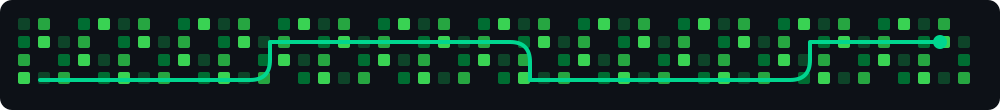
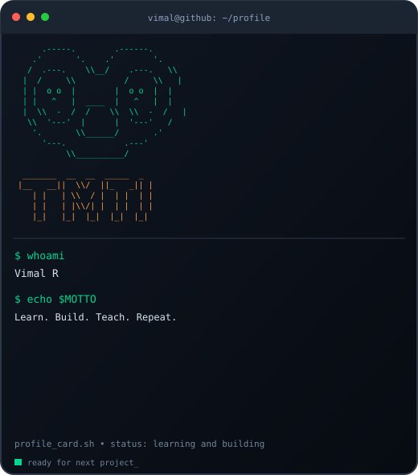
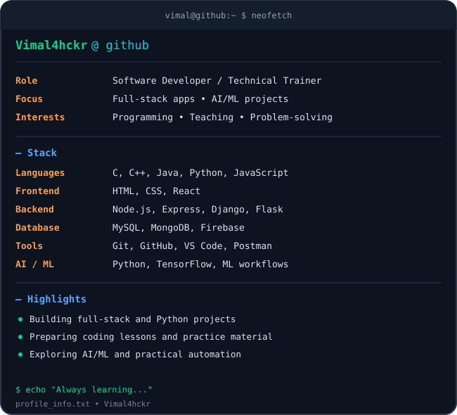

  

  

<table>
  <tr>
    <td width="42%" valign="top">
      
    </td>
    <td width="58%" valign="top">
      
    </td>
  </tr>
</table>

### Software Developer • Technical Trainer • AI/ML Explorer

*Learning, building, and teaching through practical software projects.*

---

## 🚀 About Me

- 💻 Interested in **full-stack development**, backend systems, and practical software engineering.
- 👨‍🏫 Creating programming lessons, coding exercises, and beginner-friendly technical learning resources.
- 🤖 Exploring **AI/ML and Python-based applications**.
- 🧩 Building projects involving web apps, database-backed workflows, dashboards, and automation.
- 🌱 Continuously learning, experimenting, and improving through hands-on projects.

## 🛠️ Tech Stack

  

## 💼 Project Focus

<table>
  <tr>
    <td width="50%" valign="top">

### 🌐 Full-Stack Development
Web interfaces, backend APIs, authentication, database integration, dashboards, and deployment.

    </td>
    <td width="50%" valign="top">

### 🤖 AI & Machine Learning
Python-based experiments and practical applications, including image-classification workflows.

    </td>
  </tr>
  <tr>
    <td width="50%" valign="top">

### 🧾 Practical Applications
Billing and QR verification workflows, management systems, and student-focused applications.

    </td>
    <td width="50%" valign="top">

### 👨‍🏫 Programming Education
Lesson plans, roadmaps, practice problems, MCQs, and explanations for programming topics.

    </td>
  </tr>
</table>

## 📌 Explore My Work

  

## 📊 GitHub Analytics

  
  

  

  

---

**“Build with curiosity. Learn by doing. Share what you learn.”**

  

